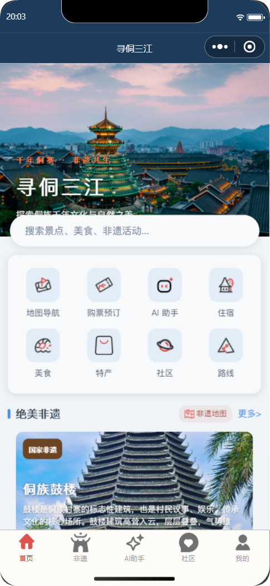

# 寻侗三江文旅平台

面向三江侗族自治县文旅场景的综合服务平台，包含游客端小程序、运营管理后台和服务端。项目围绕景区与非遗内容展示、旅游路线、酒店美食、票务订单和社区互动等功能建设，并提供 AI 问答能力。

**在线项目作品集：** https://aki-kaze.github.io/Xuandong_Sanjiang/



## 项目组成

| 模块 | 目录 | 技术栈 | 作用 |
| --- | --- | --- | --- |
| 游客端 | `Uniapp/` | UniApp、Vue | 小程序页面、旅游内容浏览、路线与订单等用户功能 |
| 管理后台 | `admin/` | Vue 3、Vite、Element Plus、Pinia、ECharts | 管理景区、路线、内容、用户及订单等运营数据 |
| Java 服务端 | `backend/` | Java 8、Spring Boot 2.7、MyBatis、MySQL、Redis | 提供核心业务 API、数据访问、缓存及管理端服务 |
| AI 辅助服务 | `Uniapp/server/` | Node.js、Express、MySQL | 提供项目中的 AI/MCP 辅助接口 |

## 功能概览

- 展示景区、酒店、美食、特产、非遗和旅游路线等内容。
- 支持用户行程、收藏、社区互动及票务、酒店、美食等订单相关页面。
- 提供运营后台，管理内容、用户、评论和各类订单，并查看数据分析页面。
- 集成 AI 问答相关页面及服务端接口。

## 环境要求

- Java 8、Maven 3.6 或更高版本
- MySQL 8
- Redis（Java 服务端启用了 Redis 缓存配置）
- Node.js 18 或更高版本、npm
- HBuilderX；如需运行微信小程序，还需微信开发者工具

## 快速开始

### 1. 准备数据库和 Redis

先启动 MySQL 与 Redis，并准备名为 `xundong_sanjiang` 的数据库及项目所需表结构。仓库不包含数据库导出文件或用户数据，请使用你自己的 schema/初始化脚本；不要将真实业务数据提交到公开仓库。

### 2. 配置并启动 Java 服务端

在仓库根目录运行：

```powershell
Copy-Item backend/src/main/resources/application.example.properties backend/src/main/resources/application.properties
```

编辑新生成的 `application.properties`，填写 MySQL、Redis、AI 和支付等本地配置。至少需要正确配置数据库地址、库名、用户名和密码。AI 与微信支付配置仅在使用相应功能时需要。

启动服务：

```powershell
cd backend
mvn spring-boot:run
```

Java API 默认监听 `http://localhost:8080`。

### 3. 启动运营管理后台

在另一个终端运行：

```powershell
cd admin
npm install
npm run dev
```

打开 `http://localhost:8081`。开发服务器会把 `/api`、`/upload` 和 `/uploads` 请求代理到本机 8080 端口。登录账号由数据库中的管理账号配置；仓库不提供默认账号密码。

生产构建：

```powershell
npm run build
```

### 4. （可选）启动 Node.js AI 辅助服务

复制 Node 服务的环境变量模板并填写本地值：

```powershell
cd Uniapp/server
Copy-Item .env.example .env
npm install
npm start
```

服务默认监听 `http://localhost:3000`。如需在线 AI 能力，请在本地 `.env` 中配置 `QWEN_API_KEY`；不要把密钥写入代码或提交到 GitHub。开发模式可运行 `npm run dev`。

### 5. 运行 UniApp 小程序

使用 HBuilderX 打开 `Uniapp/` 目录，选择浏览器或微信小程序运行目标。开发环境 API 地址配置在 `Uniapp/utils/config.js`，默认指向本机 Java 服务端 `http://127.0.0.1:8080`。

部署到真机或生产环境前，请将 API 地址改为可访问的 HTTPS 域名，并按目标平台配置合法请求域名。腾讯地图 Key 也需要换成你自己的 Key，并为其设置适当的域名限制。

## 配置与安全

- `backend/src/main/resources/application.example.properties` 是 Java 服务端配置模板。真实配置文件 `application.properties` 不应提交。
- `Uniapp/server/.env.example` 是 Node 服务配置模板；本地 `.env` 不应提交。
- 请将数据库密码、AI API Key、微信支付密钥等放在本地环境变量或未跟踪的配置文件中。
- 数据库备份、用户上传文件、依赖目录和构建产物不属于源码仓库内容。

## 文档与截图

- 后端接口说明：[`backend/API_DOCUMENTATION.md`](backend/API_DOCUMENTATION.md)
- 项目界面截图：[`image/`](image/)

## 项目状态

这是一个由小程序、运营后台和服务端组成的课程/项目型代码库。部署前请按实际数据库结构、域名、第三方服务密钥和小程序平台要求完成配置。
